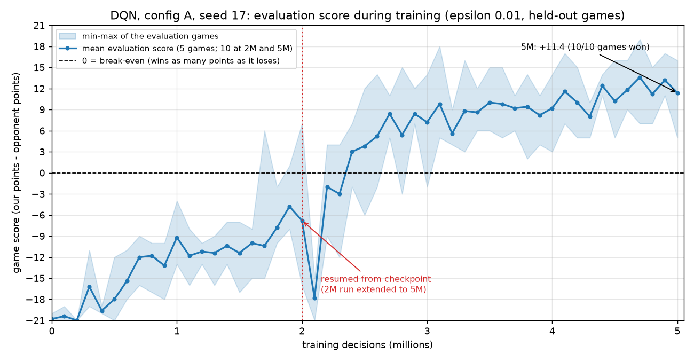

# PongProject: CS4287 Assignment 2 (Atari Pong, DQN vs Double DQN)

**Start here.** We train agents to play Atari Pong from screen pixels and compare **DQN** with **Double DQN**. The submission is one Jupyter notebook in `Assignment2/`. Everything else is support material: how we got a working setup, trained models, results and demos.

**Where we are (17 Nov 2026):**
- The original 100k-decision CPU runs never learned (score −21).
- On a laptop GPU with better settings ("config A"), one DQN run (seed 17) reached **+11.4 after 5M decisions and won 10/10 games**.
- Next: run DQN vs Double DQN with config A. See [docs/NEXT_STEPS.md](docs/NEXT_STEPS.md).



## What's in each folder

| folder | contents |
|---|---|
| [`Assignment2/`](Assignment2/) | **The submission notebook** and everything it reads (`runs/`, `results/`, `videos/`, plan files). **Don't move or rename anything in here.** |
| [`submission/`](submission/) | `actual_submission/`: the 2 files we upload (the notebook and the PDF write-up). `writeup_source/`: how the PDF is built (text, figures, build script). |
| [`docs/`](docs/) | The assignment brief (.docx), [SETUP](docs/SETUP.md), [WHAT_WE_DID](docs/WHAT_WE_DID.md) (the story so far), [CONFIG_A](docs/CONFIG_A.md) (all settings compared), [NEXT_STEPS](docs/NEXT_STEPS.md) and [AI_USE_LOG](docs/AI_USE_LOG.md). |
| [`models/`](models/) | Trained policies, e.g. `dqn_configA_seed17_5.0M.pt`, with a table of their scores and the command to watch each one. |
| [`results/`](results/) | Graphs (learning curve, old vs new settings), score tables, behaviour analyses and GPU speed results. |
| [`experiments/`](experiments/) | Every script we ran, in numbered stages `01`–`06`, each with a README (purpose, command, key result) and its recorded logs and CSVs. |
| [`demos/`](demos/) | Play Pong yourself, watch our AI play, or see what the AI is "thinking". |
| [`common/`](common/) | Shared code: the notebook's training code (extracted verbatim) and our additions (Nature network, fixed checkpointing). |

## Quick start (Windows PowerShell, from this folder)

**1. Set up the venv with CUDA torch** (details and troubleshooting: [docs/SETUP.md](docs/SETUP.md))

```powershell
py -3.12 -m venv .venv
.venv\Scripts\python -m pip install -r Assignment2\requirements.txt
.venv\Scripts\python -m pip install torch==2.15.0 --index-url https://download.pytorch.org/whl/cu132 --no-deps --force-reinstall
.venv\Scripts\python -c "import torch; print(torch.__version__, torch.cuda.is_available())"
```

**2. Play Pong yourself.** The opponent is the game's built-in bot, *not* our AI. W/S to move, Space to serve.

```powershell
.venv\Scripts\python demos\play_pong.py
```

**3. Watch our AI play**, and see what it's thinking

```powershell
.venv\Scripts\python demos\watch_ai.py                                         # best model (5.0M)
.venv\Scripts\python demos\watch_ai.py models\dqn_oldsettings_seed17_0.6M.pt   # an early, bad agent
.venv\Scripts\python demos\explain_ai.py                                       # live Q-values + behaviour plots
```

**4. Reproduce training** (config A, DQN, seed 17)

```powershell
.venv\Scripts\python experiments\04_diagnosis\test_core.py                 # correctness tests: 11/11 should pass
.venv\Scripts\python experiments\05_configA_2M\run_A.py --dry-run          # print the exact settings
.venv\Scripts\python experiments\05_configA_2M\run_A.py                    # 0 -> 2M, ~1.6 h on an RTX 5050 (re-run to resume)
.venv\Scripts\python experiments\06_configA_extend_5M\run_A_ext.py         # 2M -> 5M, ~2.5 h
.venv\Scripts\python results\make_plots.py                                 # rebuild graphs from the recorded logs
```

Training needs about 6 GB of free RAM and about 3 GB of disk per run. Close other apps and stop the laptop sleeping first. Run outputs go to `experiments\<stage>\output\`, which is git-ignored.

**5. The notebook:** open `Assignment2\CS4287-Assign2_Atari_ID1_ID2_ID3.ipynb` with the `.venv` kernel. See `Assignment2\README.md`.

## Rules for this repo

- `Assignment2/` stays exactly as the notebook needs it.
- Never commit `.venv/`, replay buffers (`*.npy`) or new `checkpoint.pt.gz` files; `.gitignore` handles this.
- Any change to training must apply identically to DQN and Double DQN.
