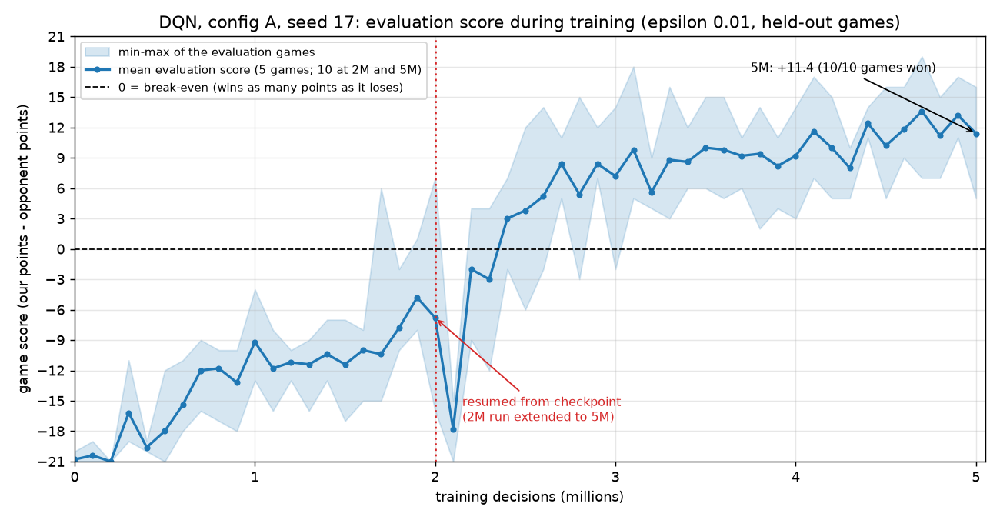

# What we did, in plain English

The question for the assignment: **does Double DQN learn Atari Pong better than plain DQN?** Before we could compare them, we needed an agent that learns Pong at all. This page tells how we got there. The scripts and logs for each step are in [`experiments/`](../experiments/).

## 1. Tommy's CPU runs never learned (score −21)

The notebook in `Assignment2/` was built and run on a laptop CPU, which managed about 97 decisions per second. A decision means the agent picks one action, which covers 4 game frames. The plan (`Assignment2/experiment_plan.json`) gave 6 runs (DQN and Double DQN × seeds 17, 29, 43) of **100,000 decisions each**, because that was all a CPU could do in reasonable time.

Result: the final means were **−21.00 (DQN)** and **−20.97 (Double DQN)**. The agent lost every point, so the runs can't tell the methods apart.

## 2. GPU setup (16 Nov)

We checked whether a laptop GPU (RTX 5050) could do more: [SETUP.md](SETUP.md), `experiments/01` and `02`.

- We installed the CUDA build of the same torch version. Windows Smart App Control had to be switched off because it blocked torch's DLLs.
- We ran the notebook's training code unchanged (copied verbatim into `common/pong_train_extract.py`). It ran at about 490 decisions/s, roughly 5× Tommy's CPU.

## 3. Pilot with the old settings (16 Nov)

We ran one longer test: DQN, seed 17, with the notebook's own settings (small network, replay 100k), aiming for 1M decisions. See `experiments/03_pilot_old_settings`.

- It was **killed at about 700k decisions**. Windows ran out of memory while the notebook's code was saving a checkpoint, because that code briefly needs about 3.9× the replay buffer's size in extra RAM. The last good checkpoint was at 600k.
- By then it was still losing badly: the evaluation score went from −21 to about **−17 to −20**.
- Watching it play (`demos/watch_ai.py`) and analysing it (`demos/explain_ai.py`) showed the paddle **camping at the bottom** about 75% of the time and jittering. It missed balls it could easily have reached, and its Q-values barely reacted to where the ball was.

## 4. Diagnosis: no learning bug, just too little training and too small a network (16 Nov)

The full report is [`experiments/04_diagnosis/report.txt`](../experiments/04_diagnosis/report.txt).

- **Correctness tests: 11 of 11 pass.** We checked frame stacking and what the network sees ([`observations.png`](../experiments/04_diagnosis/observations.png)), the replay buffer (byte-identical to real gameplay), the DQN and Double DQN targets, the loss, the target-network sync, sticky actions, reward clipping and the action mapping. No learning bug was found.
- **The training logs looked healthy.** There was no divergence. Q-values first fell (the agent learning that it was losing), then started rising at about 400k decisions as rallies got longer.
- **The real causes:**
  - Far too little training. Published DQN results for Pong use 10M steps; 100k is 1% of that.
  - A small network, about 4× smaller than the standard "Nature DQN" network.
  - A small replay buffer.
  - Sticky actions, which make Pong harder. We kept them: they are the fair, modern protocol.
- **Two engineering bugs found and fixed.** Both fixes are in `common/pong_train_diag.py`; the notebook itself is unchanged.
  1. **Checkpoint RAM spike.** The notebook pickles the whole replay buffer into a gzip file, which needs about 3.9× its size in RAM. The fix saves the replay arrays as raw `.npy` files instead. Peak extra RAM during a save dropped from +5.1 GB to about 0, and saves went from 6–8 s to about 1 s.
  2. **CUDA resume bug.** `Trainer.load()` crashes on a GPU because it moves the CPU random-number state onto the GPU. The fix loads to CPU first. The notebook only ever ran on CPU, so the bug never showed.

## 5. Config A (16 Nov)

We aligned the settings with a published DQN configuration known to learn Pong (CleanRL), as far as the laptop allows. The changes are the Nature network, replay 200k, target sync every 1,000, epsilon 1.0→0.01 over 100k and learning starts at 20k. They apply identically to DQN and Double DQN. On this GPU they cost no extra time. Full table: [CONFIG_A.md](CONFIG_A.md).

Over the first 1M decisions, config A was already clearly ahead of the old settings: about **−9 vs −17** ([`results/old_vs_new_settings.png`](../results/old_vs_new_settings.png)).

## 6. The long run: DQN, config A, seed 17, 5M decisions (16–17 Nov)

- **0 → 2M** (`experiments/05`, 1.6 h): the score rose steadily from −21 to about −5 … −7.
- **2M → 5M** (`experiments/06`, 2.5 h): we resumed from the 2M checkpoint. The only setting changed was `total_steps`.
  - The score went positive at about **2.4M** and kept rising.
  - At 5M, the 10-game final evaluation gave **+11.4, and it won all 10 games** (per-game scores +5 to +16).
- **Unexplained dip right after resuming.** At 2.1M, the first evaluation after the resume, the score dropped to **−17.8**. It was −6.8 at 2M and −2.0 at 2.2M. We have **not explained this**. It could be ordinary evaluation noise (only 5 games, and the 2M games themselves ranged from −16 to +7), or something about the resume. Resuming was tested to be exact on short runs, but not on this run. Keep it in mind when resuming future runs.
- Watching the 5.0M model, it now tracks the ball, wins rallies and beats the built-in opponent, for example 21:11 in the game we checked.

## Where this leaves us

We now have settings that **do** learn Pong on this laptop. The main experiment, DQN vs Double DQN, still has to be run with these settings for both methods and all three seeds. See [NEXT_STEPS.md](NEXT_STEPS.md).
