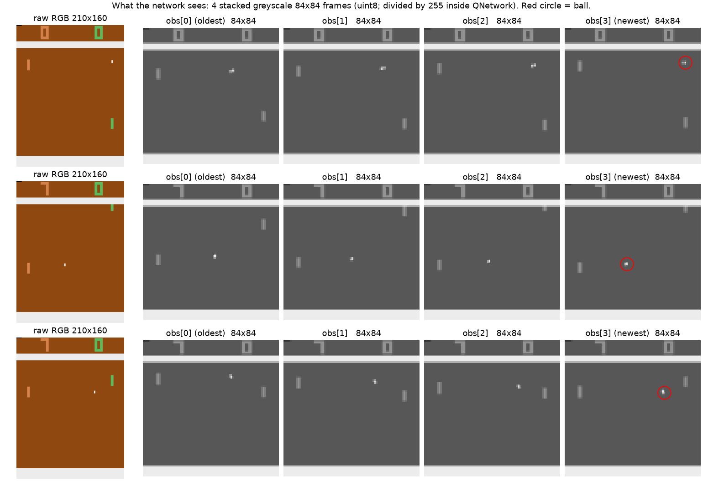
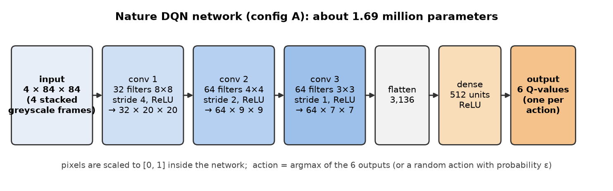
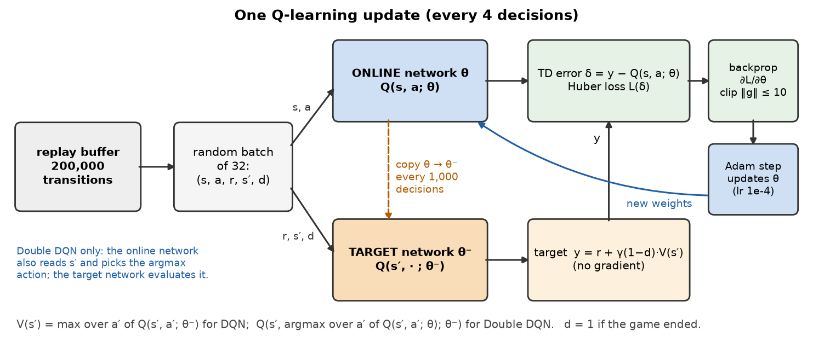
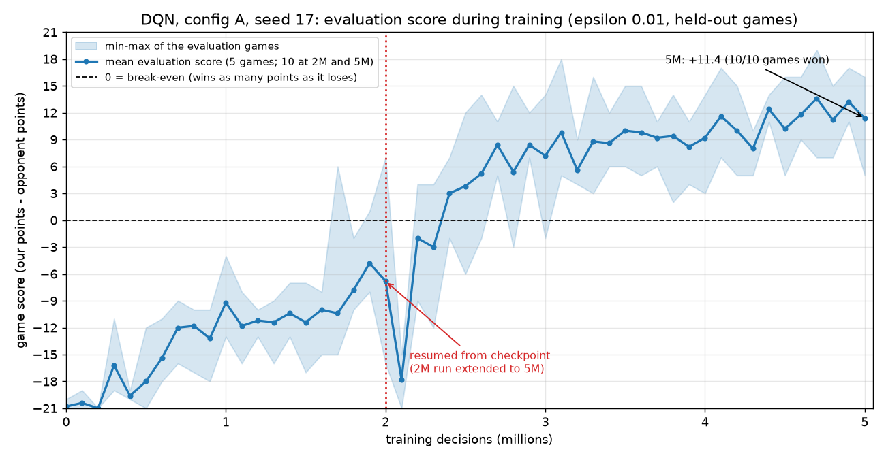
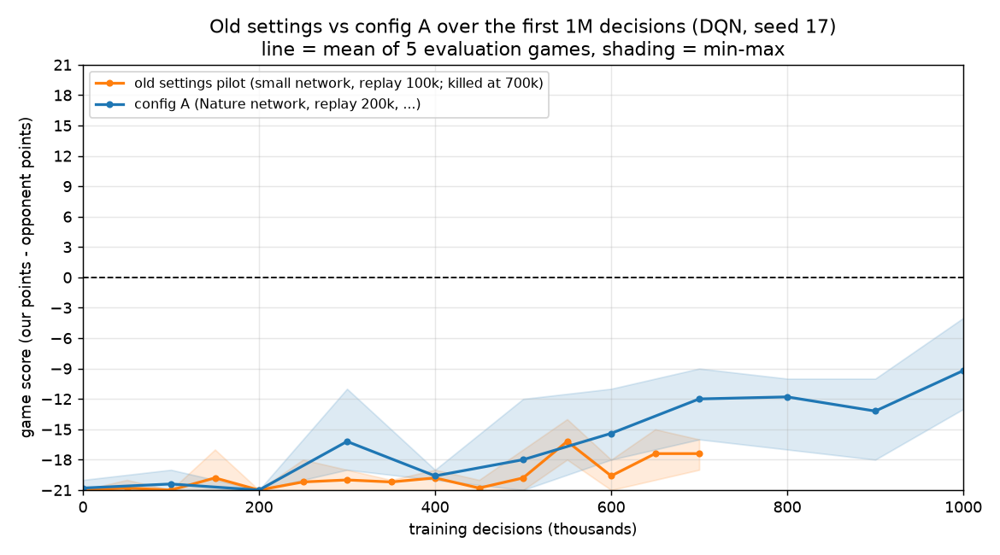

:::note
**About this draft.** The marked submission is the Jupyter notebook. This write-up summarises the project in plain English.
- Every number below is taken from a recorded file in the project repository: run logs, `evaluations.csv`, test results and behaviour summaries.
- One configuration ("config A") has been trained with one seed so far.
- The main DQN vs Double DQN comparison with config A has **not been run yet**. Its results are marked [RESULTS PENDING].
:::

# 1. Why reinforcement learning suits Pong

In Pong, an agent controls a paddle and must return a ball past a computer opponent. Nobody gives it a "correct" action for each screen. The only feedback is the score: +1 when the opponent misses and −1 when we miss, often dozens of frames after the moves that caused it. This rules out supervised learning: there is no labelled dataset of good moves, and the labels we could invent (for example "move towards the ball") would encode our own guesses rather than what actually wins points.

Reinforcement learning (RL) fits this problem exactly. An agent interacts with an environment, receives a reward signal and learns a policy that maximises the total future reward. RL handles the three hard parts of Pong:

- **Delayed credit assignment.** The value of a move depends on rewards that arrive later. Q-learning propagates reward backwards in time through the Bellman equation.
- **Learning from experience the agent itself collects.** The agent's own actions decide which situations it sees, so exploration (ε-greedy) and learning are linked.
- **High-dimensional input.** The state is a raw screen. Deep Q-Networks (DQN) combine Q-learning with a convolutional network that reads pixels directly. They were shown to reach human-level play on many Atari games, including Pong, from the screen and score alone [1].

Unsupervised learning could find structure in the frames, but it has no notion of winning. RL is therefore the paradigm of choice.

# 2. The Gym environment

We use **ALE/Pong-v5** from Gymnasium with the Arcade Learning Environment (ale-py 0.12.1) [5, 6]. We are the **green paddle on the right**; the opponent is the game's built-in computer player.

| property | value in our setup |
|---|---|
| raw observation | 210 × 160 RGB screen (uint8) |
| actions | 6 (minimal set): NOOP, FIRE, RIGHT (moves **up**), LEFT (moves **down**), RIGHTFIRE, LEFTFIRE |
| reward | +1 when we win a point, −1 when we lose one, 0 otherwise. A game ends when one side reaches 21 points, so a game score runs from −21 to +21. |
| sticky actions | probability 0.25 per emulator frame that the previous action is repeated instead of the chosen one. On in training **and** evaluation. |
| episode limit | 27,000 decisions (truncation; the agent still bootstraps after a time cut) |

**Sticky actions** are the modern evaluation protocol recommended by Machado et al. [4]. They make the game slightly random, so an agent can't win by memorising one exact sequence of button presses. ALE's own sticky option is switched off and a small wrapper applies p = 0.25 once per raw frame, so the effect is not applied twice. A unit test measured the stick rate at 0.251. The action meanings (RIGHT = up) and the paddle and ball positions were verified against the Atari RAM and screen pixels.

# 3. Implementation

All training code lives in the submission notebook. The same code is extracted verbatim into `common/pong_train_extract.py` so it can also run from scripts.

## 3(a) Capture and pre-processing of the data

**Capture.** The agent plays the game and stores every transition (state, action, reward, next state, terminated, truncated) in a **replay buffer**. Learning starts once the buffer holds `learning_starts` transitions. Each update then samples a random mini-batch of 32 transitions from the buffer. Random sampling breaks the strong correlation between consecutive frames and lets each experience be reused many times.

**Pre-processing** uses Gymnasium's standard `AtariPreprocessing` plus a 4-frame stack:

1. **No-op starts:** each game begins with a random 0–30 no-op actions, so start positions vary.
2. **Frame skip 4:** each chosen action is repeated for 4 emulator frames. One *decision* is therefore 4 frames, and the maximum of the last two frames is taken to remove Atari flicker.
3. **Greyscale and resize** to 84 × 84 pixels (stored as uint8 to save memory).
4. **Stack the last 4 frames** into one 4 × 84 × 84 state. A single frame cannot show which way the ball is moving; four frames can.
5. **Scale to [0, 1]** (divide by 255) inside the network.
6. **Reward clipping:** the learner stores sign(r) ∈ {−1, 0, +1}. Raw scores are kept for reporting.

The replay buffer stores only two 84 × 84 frames per transition and rebuilds the stacks when sampling. A test on 1,500 real gameplay steps, including episode boundaries and the ring buffer wrapping around, confirmed that every sampled state is byte-identical to what the environment produced.

{width=0.82}

## 3(b) Network structure

The Q-network maps a state to one Q-value per action: an estimate of the total discounted future reward for taking that action now and playing well afterwards. We use the standard **"Nature" DQN architecture** [1], the same as in the CleanRL reference implementation [7]:

| layer | details | output shape |
|---|---|---|
| input | 4 stacked greyscale frames, uint8 → /255 | 4 × 84 × 84 |
| conv 1 | 32 filters, 8 × 8, stride 4, ReLU | 32 × 20 × 20 |
| conv 2 | 64 filters, 4 × 4, stride 2, ReLU | 64 × 9 × 9 |
| conv 3 | 64 filters, 3 × 3, stride 1, ReLU | 64 × 7 × 7 |
| flatten | | 3,136 |
| dense | 512 units, ReLU | 512 |
| output | linear, one value per action | 6 |

That gives about 1.69 million parameters. The convolutions detect the paddles, the ball and their motion across the 4 frames; the dense layers combine them into action values. The notebook's original network was a smaller CNN (16-32-32 filters, 256 dense units, about 425 thousand parameters) chosen to be CPU-friendly. Section 7 explains why we switched.

{width=0.85}

## 3(c) The Q-learning update applied to the weights

The function `learning_update` in the notebook runs once every 4 decisions (`train_frequency = 4`). For a mini-batch of 32 transitions (s, a, r, s′, d) it does the following. Here d = 1 if the game really ended after s′ and 0 otherwise.

{width=0.92}

**Step 1: prediction.** The online network θ computes Q(s, ·; θ) for all 6 actions. We keep only the value of the action actually taken: Q(s, a; θ).

**Step 2: target.** Using the Bellman equation, the target is the reward plus the discounted value of the best next action:

```
DQN:         y = r + γ (1 − d) · max_a′ Q(s′, a′; θ⁻)
Double DQN:  y = r + γ (1 − d) · Q(s′, argmax_a′ Q(s′, a′; θ); θ⁻)
```

- γ = 0.99 is the discount factor, and θ⁻ is the **target network**.
- The term (1 − d) removes the future value when the game is over. A time-limit truncation is not a real ending, so it still bootstraps.
- The target is computed under `torch.no_grad()`. It is treated as a fixed number, and no gradient flows through it.
- The *only* line that differs between DQN and Double DQN is `bootstrap_values`. In DQN the target network both chooses and evaluates the next action. In Double DQN the online network chooses it and the target network evaluates it (Section 6).

**Step 3: TD error and loss.** The temporal-difference (TD) error is δ = y − Q(s, a; θ). The loss is the **Huber loss** (smooth L1), averaged over the batch:

```
L(δ) = ½ δ²          if |δ| ≤ 1
L(δ) = |δ| − ½       otherwise
```

Huber is quadratic for small errors and linear for large ones. Large, noisy TD errors therefore cannot produce huge gradients. This is the "error clipping" used in the Nature paper [1]. A unit test confirmed the loss equals the Huber value (0.248 against 0.496 for MSE on the same batch).

**Step 4: backpropagation.** The old gradients are cleared, then `loss.backward()` applies the chain rule through the dense and convolutional layers. This gives ∂L/∂θ for every weight: how much each weight contributed to the prediction error.

**Step 5: gradient clipping.** The total gradient norm is clipped to 10, identically for both methods. In the logs it never reached this limit (typical norm about 0.2).

**Step 6: weight update.** Adam (learning rate 1×10⁻⁴) moves each online weight a small step against its gradient. Roughly, θ ← θ − α · ∂L/∂θ, with Adam's per-weight scaling. The target network is not touched by the optimiser.

**Target network.** Every `target_update_interval` decisions (1,000 in config A), the online weights are copied into θ⁻. Between copies, the targets come from a fixed network. Without it, every update would move the target it is chasing, which can make learning oscillate or diverge.

**Exploration.** Actions are chosen ε-greedily. ε falls linearly from 1.0 to 0.01 over the first 100,000 decisions (config A), then stays at 0.01.

# 4. Results

All results in this section are from **one DQN training run with config A, seed 17**, trained for 5 million decisions on an NVIDIA RTX 5050 laptop GPU:
- 0 → 2M took 1.60 h;
- the run was then resumed from its 2M checkpoint and extended to 5M, which took 2.48 h more.

**Evaluation protocol.** Every 100,000 decisions the agent plays 5 games, and 10 games at the end of each session (2M and 5M). The games use a separate environment, held-out seeds, ε = 0.01 and no learning. The score of a game is our points minus the opponent's (−21 to +21).

{width=0.9}

| decisions | mean score | games | range |
|---|---|---|---|
| 0 | −20.8 | 5 | −21 to −20 |
| 1,000,000 | −9.2 | 5 | −13 to −4 |
| 2,000,000 | −6.8 | 10 | −16 to +7 |
| 2,100,000 | −17.8 | 5 | −21 to −15 |
| 2,400,000 | +3.0 (first positive mean) | 5 | −2 to +7 |
| 3,000,000 | +7.2 | 5 | −2 to +14 |
| 4,000,000 | +9.2 | 5 | +3 to +14 |
| **5,000,000** | **+11.4 (won all 10 games)** | 10 | **+5 to +16** |

**Old settings vs config A.** Before config A, a pilot with the notebook's original settings (small network, replay 100k) had reached only −19.6 at 600k decisions and −17.4 at 700k, when it was stopped. Over the same period, config A was already clearly ahead, and it reached −9.2 by 1M.

{width=0.68}

**Behaviour before and after.** We built an analysis tool (`explain_ai.py`). It replays a held-out evaluation game and reads the paddle and ball positions from the Atari RAM. The table compares the old 0.6M agent with the 5M agent, one game each:

| metric (one held-out game each) | old settings, 0.6M | config A, 5.0M |
|---|---|---|
| final score (us : opponent) | 1 : 21 | 21 : 11 |
| incoming balls / points lost | 26 / 21 | 48 / 11 |
| paddle in bottom third while ball approaches | 77% | 43% |
| paddle in bottom third when no ball in play | 79% | 18% |
| first move towards the ball's arrival point (median, % of approach) | 29% | 8% |
| when chasing the ball and heading for its arrival point disagree: heads to arrival | n/a (0 cases) | 67% |
| median miss distance on lost points | 98 px | 20 px |
| lost points that were reachable from the paddle's position | 95% | 100% |
| median highest Q-value (the agent's own value estimate) | −0.69 | +1.13 |

The old agent "camped" in the bottom third of the court and missed balls by about 100 pixels. The 5M agent spreads over the whole court, starts moving towards where the ball *will* arrive much earlier, and loses far fewer points; when it does miss, it misses narrowly. Its value estimate is positive, which means it expects to win points. Not every indicator improved, though. The simple correlation between paddle height and ball height while the ball approaches was 0.36 for the old agent and 0.30 for the 5M agent, because the 5M agent heads for the arrival point rather than shadowing the ball.

{width=0.92}

The notebook includes gameplay videos of the original runs. Videos of the config A agent can be produced with the repository's `demos/watch_ai.py`.

# 5. Evaluation of the results

**How do we evaluate an RL agent?** There is no test set of labelled examples. We let the trained agent *act* and measure the outcome, keeping evaluation separate from training:
- a separate environment instance with held-out seeds, so the games differ from the ones it trained on;
- no weight updates and no replay writes during evaluation;
- a small fixed ε = 0.01, the usual Atari protocol, which also prevents getting stuck;
- sticky actions still on;
- the raw game score (not the clipped reward).

The notebook's declared metrics are:
1. the final mean score over 10 held-out games, averaged across 3 training seeds;
2. learning speed, as the area under the evaluation curve and the first checkpoint with mean score ≥ 0;
3. consistency, as the standard deviation across seeds.

**Are the metrics we have seen to date relevant?** Partly. Metrics from supervised learning, such as accuracy, precision or a falling training loss, do not measure RL performance:
- The DQN loss is measured against *moving* targets. It can rise while the agent improves; our loss rose after about 400k decisions exactly when play started to get better.
- Mean Q-values estimate return under the agent's own beliefs and can be biased (Section 6).

What matters is the score the policy achieves. Training-episode returns are also biased, because they include exploration. Two further measures help. Wall-clock time and decisions per second show the cost. Behaviour metrics, such as paddle position and how early the agent moves to the ball's arrival point, explain *why* the score changes.

**Limitations of our current results:**
- **One seed.** RL results vary strongly between training seeds. A single run shows that config A *can* learn Pong, not how reliably it does.
- **Small evaluations.** 5 games per checkpoint (10 at the end) give noisy means; single checkpoints jump by several points.
- **Unexplained dip after resuming.** The first evaluation after resuming at 2M fell to −17.8 (from −6.8 at 2M, recovering to −2.0 at 2.2M). We have not explained it. It may be evaluation noise, since the 2M games themselves ranged from −16 to +7, or something about the resume. Exact resumption was verified on short runs but not on this run. The main experiment will therefore run each training run straight through.
- **Below the published level.** The CleanRL reference reports 20.25 ± 0.41 on PongNoFrameskip-v4 after 10M steps [7]. That environment version has no sticky actions by default [6]. We reached +11.4 after 5M with sticky actions, a smaller replay buffer (200k vs 1M) and half the training.
- **Behaviour statistics** come from one game per agent.

# 6. Independently researched concept: Double DQN and maximisation bias

**The problem.** The DQN target uses max_a′ Q(s′, a′). Q-values are noisy estimates (call them Q_est), and the maximum of several noisy estimates is biased upwards: E[max_a Q_est(a)] ≥ max_a E[Q_est(a)]. Even if every estimate were unbiased on its own, picking the largest one tends to pick an *overestimated* one. This is **maximisation bias** [2, 3]. Because each target is built from other estimates, the overestimation propagates through bootstrapping. van Hasselt et al. showed that DQN substantially overestimates values on several Atari games, and that this can harm the learned policies [2].

**The fix.** Double Q-learning [3] decouples *choosing* the next action from *evaluating* it. In Double DQN [2] the online network chooses the action and the target network, already available in DQN, evaluates it:

```
DQN:         y = r + γ (1 − d) · Q(s′, argmax_a′ Q(s′, a′; θ⁻); θ⁻)     same network chooses and evaluates
Double DQN:  y = r + γ (1 − d) · Q(s′, argmax_a′ Q(s′, a′; θ);  θ⁻)     online chooses, target evaluates
```

An action that only *looks* good because of the target network's noise is less likely to be chosen by the online network as well, so the bias shrinks. The change costs one extra forward pass of the online network on s′.

**Our implementation.** Double DQN is coded in the notebook as a single switch, `method = "double_dqn"`, in `bootstrap_values` (Section 3c). Everything else is identical for both methods: the network, the hyper-parameters, the seeds and the evaluation. Unit tests check both formulas. On the GPU, Double DQN ran about 5% slower (461.5 against 486.8 decisions/s).

**Evaluation of its efficacy.** The notebook's original comparison used 100,000 decisions per run on a CPU. Neither method learned in that time (final means −21.00 for DQN, −20.97 for Double DQN), so it cannot show any difference. The planned comparison is DQN vs Double DQN × seeds 17, 29, 43, with config A and 3M decisions each. It will report:
- final score;
- learning speed;
- consistency across seeds;
- the mean Q-value against the actually achieved return, which is a direct check of overestimation.

**[RESULTS PENDING: the DQN vs Double DQN comparison with config A has NOT been run yet. Insert the learning curves, the final-score table (mean ± SD over 3 seeds) and the Q-value-vs-return plot here when the main experiment is complete.]**

# 7. Engineering story: from −21 to +11.4

1. **CPU runs never learned.** The notebook was developed on a laptop CPU (about 97 decisions/s). Its plan gave 6 runs (DQN and Double DQN × 3 seeds) of 100,000 decisions each. The final means were −21.00 and −20.97: the agents lost every point.
2. **GPU setup.** On a laptop with an RTX 5050 we installed the CUDA build of the same PyTorch version (2.15.0+cu132). Windows Smart App Control had to be switched off because it blocked PyTorch's libraries. The notebook's code ran unchanged at 486.8 (DQN) and 461.5 (Double DQN) decisions/s. GPU utilisation was only about 16%, because emulation and Python overhead dominate with such a small network.
3. **Pilot with the original settings.** A 1M-decision pilot was killed at about 700k by a low-memory event. The notebook's checkpoint code needs about 3.9× the replay buffer's size in extra RAM while saving (8.25 GB peak with a 100k buffer). The agent was still at −17 to −20.
4. **Diagnosis.**
   - All 11 correctness tests passed, covering pre-processing, replay buffer, both targets, loss, target sync, ε schedule, sticky actions, reward clipping and actions, and the training logs were healthy. **There was no learning bug.**
   - The causes were too little training (100k is 1% of the 10M used by the reference), a network about 4× smaller than standard, and a small replay buffer.
   - Two engineering bugs were fixed outside the notebook. The checkpoint RAM spike was fixed by saving the replay as raw arrays: extra RAM during a save went from +5.1 GB to about 0. A crash when resuming on a GPU was fixed by loading checkpoints to the CPU first.
5. **Config A.** We aligned the settings with CleanRL's DQN for Atari [7] as far as the laptop allows, identically for both methods, at no extra time cost:

| setting | notebook original | config A | CleanRL reference [7] |
|---|---|---|---|
| training budget (decisions) | 100,000 | 5,000,000 so far (3M planned) | 10,000,000 |
| network | small CNN 16-32-32 / 256 | Nature CNN 32-64-64 / 512 | Nature CNN |
| replay buffer | 20,000 | 200,000 (RAM limit) | 1,000,000 |
| learning starts | 2,000 | 20,000 | 80,000 |
| target network copy every | 2,000 | 1,000 | 1,000 |
| ε schedule | 1.0 → 0.05 over 80k | 1.0 → 0.01 over 100k | 1.0 → 0.01 over 1M |
| loss / optimiser / lr | Huber / Adam / 1e-4 | Huber / Adam / 1e-4 | MSE / Adam / 1e-4 |
| batch / γ / train frequency | 32 / 0.99 / 4 | 32 / 0.99 / 4 | 32 / 0.99 / 4 |
| environment | Pong-v5, sticky 0.25 | Pong-v5, sticky 0.25 | PongNoFrameskip-v4 (no sticky actions by default) |

6. **Result.** With config A, DQN seed 17 went from −20.8 to −6.8 at 2M and +11.4 at 5M, winning all 10 final games (Section 4).

# 8. Statement of work

[PLACEHOLDER: Name 1 (ID1). One paragraph describing this member's contribution.]

[PLACEHOLDER: Name 2 (ID2). One paragraph describing this member's contribution.]

[PLACEHOLDER: Name 3 (ID3). One paragraph describing this member's contribution.]

# 9. Use of generative AI

Generative AI (Claude, through Claude Code and Claude chat) was used for the following:
- the GPU setup checks;
- writing measurement and diagnosis scripts outside the notebook;
- running and monitoring the long training runs;
- building the analysis and demo tools;
- organising the repository;
- drafting this write-up.

All numbers come from logged runs, not from the AI. The full listing of every prompt, a one-line summary of each response and how it was used is in `docs/AI_USE_LOG.md` in the repository. The complete log, together with earlier records in `Assignment2/AI_USE_LOG.json`, will be included in the submitted notebook as the brief requires. [PLACEHOLDER: add other team members' AI use.]

# 10. References

[1] V. Mnih et al., "Human-level control through deep reinforcement learning," *Nature*, vol. 518, pp. 529–533, 2015.

[2] H. van Hasselt, A. Guez and D. Silver, "Deep reinforcement learning with Double Q-learning," in *Proc. AAAI Conference on Artificial Intelligence*, 2016.

[3] H. van Hasselt, "Double Q-learning," in *Advances in Neural Information Processing Systems 23*, 2010.

[4] M. C. Machado et al., "Revisiting the Arcade Learning Environment: evaluation protocols and open problems for general agents," *Journal of Artificial Intelligence Research*, vol. 61, pp. 523–562, 2018.

[5] M. G. Bellemare, Y. Naddaf, J. Veness and M. Bowling, "The Arcade Learning Environment: an evaluation platform for general agents," *Journal of Artificial Intelligence Research*, vol. 47, pp. 253–279, 2013.

[6] Farama Foundation, *Gymnasium* documentation, https://gymnasium.farama.org, and *ALE* Pong documentation, https://ale.farama.org/environments/pong/

[7] S. Huang et al., "CleanRL: high-quality single-file implementations of deep reinforcement learning algorithms," *Journal of Machine Learning Research*, vol. 23, no. 274, 2022. DQN for Atari: https://docs.cleanrl.dev/rl-algorithms/dqn/#dqn_ataripy

[8] R. S. Sutton and A. G. Barto, *Reinforcement Learning: An Introduction*, 2nd ed. MIT Press, 2018.
